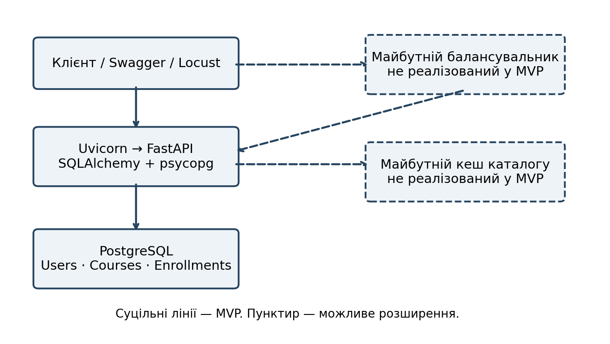

# Архітектура Магічної Академії

MVP — один синхронний FastAPI-процес і PostgreSQL. Вибір теми дає просту й наочну
конкурентну операцію: кілька студентів претендують на останнє місце на курсі.
Три сутності достатні, щоб показати автентифікацію, RBAC, IDOR, транзакції та навантаження.

Клієнт → HTTP/Uvicorn → FastAPI → SQLAlchemy Session → psycopg → PostgreSQL.
Синхронні обробники FastAPI виконуються у thread pool. Кожний запит отримує власну Session.
JWT визначає user_id, після чого роль читається з БД, а не приймається від клієнта.

Майбутній балансувальник міг би розподіляти запити між копіями API, а кеш — прискорювати
перегляд каталогу. Вони зображені пунктиром лише як розвиток архітектури для ЛР1.
У MVP ці сервіси не розгорнуто. Кількість місць перевіряється тільки в БД, не в кеші.

## Конкурентна реєстрація

`SELECT course FOR UPDATE` блокує рядок курсу до завершення транзакції. Потім запит перевіряє
дубль, рахує записи і додає Enrollment лише якщо count < capacity. Commit зберігає запис
і відпускає блокування. Наступний запит за стандартного PostgreSQL READ COMMITTED бачить
вже актуальний count. Блокування спільне для потоків і копій API, на відміну від Python Lock.
Unique(user_id, course_id) захищає від дублювання навіть при помилці прикладного коду.

Гарантія місткості спирається на правило: всі операції додавання проходять через цю транзакцію.
Прямі сторонні INSERT в БД обходять її. Capacity після створення курсу не змінюється.
MVP не має скасування запису, редагування місткості чи публічного створення ADMIN.
При HTTP-помилці закриття Session відкотить відкриту транзакцію і звільнить блокування.

## Розміщення коду

- app/main.py — HTTP-маршрути й проста бізнес-логіка.
- app/models.py, schemas.py — таблиці та валідація HTTP-даних.
- app/security.py — Argon2id і JWT.
- app/config.py, database.py — конфігурація, engine та сесії.
- app/manage.py — локальне створення адміністратора.
- tests/ — unit, HTTP/ORM та окремі PostgreSQL-конкурентні тести.
- load/ і scripts/ — навантаження, збір метрик та перевірки.

Поділ обмежений відповідальністю модулів. Repository pattern, мікросервіси та frontend не потрібні.
